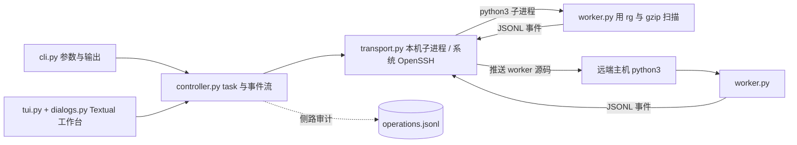

# log-search

Python CLI 与 Textual 日志检索工具，支持本机及系统 OpenSSH 远端查询。默认搜索各服务的 `logs/`，包括业务服务、历史目录、含 NUL 的滚动分片、无扩展名文件和 gzip。

安装见 [docs/install.md](docs/install.md)。三条最快能用的命令：

```bash
log-search --query 'TRACE'                                    # 裸跑：本机 + 当前目录 + 当天，先回显完整命令再确认
log-search search --host demo --root /srv/app-logs --query 'TRACE'
log-search logs --local --root /srv/app-logs                  # 先看发现了哪些日志目录
```

## 架构



图看不出来的六件事：

1. **两个 UI 入口共用一套 task API**。`controller.py` 不 import textual，CLI 能做的 TUI 都能做；反向不成立 —— 导出和 `diagnostics` 只在 CLI。
2. **`worker.py` 是自包含单文件**，只用标准库加外部 `rg`/`gzip`。远端不安装、不落盘：源码经 SSH 的 stdin 一次性推送后执行。
3. **UI 与 worker 之间是单向 JSONL 协议**：stdin 一个 JSON 请求，stdout 逐行事件 `ready` / `progress` / `entry` / `warning` / `logs` / `context` / `done`，单条上限 1 MiB。取消、超时、上限都靠这些事件表达，不靠异常。
4. **执行位置由 `transport.py` 决定**，两种：本机 `python3 worker` 子进程，或复用 OpenSSH ControlMaster 长连接打到远端。上层不知道差别，所以本机能跑的行为远端也能跑。
5. **审计走侧路**，操作日志不进 stdout，因此 `--format jsonl | jq` 是干净的。详见 [docs/logging.md](docs/logging.md)。
6. `grouping.py`（结果聚合）、`clipboard.py`（复制回退）、`export.py`（导出脱敏）只在 UI 侧；`config.py` 管 SSH config 解析与偏好文件。

路径与目录形状的硬约束（必须绝对路径、嵌套目录去重、符号链接不跟随）集中在 [docs/limits.md](docs/limits.md)。

## TUI 核心使用

```bash
log-search tui --root /srv/app-logs
log-search tui --host demo --root /srv/app-logs --ssh-config ~/.ssh/config
```

主屏只有四行结构：查询输入、分隔线、日志列表、状态行。

| 想做 | 按键 |
| --- | --- |
| 搜索 | 查询框输入后 Enter |
| 打开全屏详情 | 双击该行，或选中后 Enter |
| 返回原位置 | Esc |
| 回到查询框 | Ctrl+F |
| 查询框 / 列表之间切焦点 | Tab |
| 重查 / 取消当前任务 | r / x |
| 复制选中（无选中则复制整条详情） | 详情内 Ctrl+C |
| 复制当前详情全部内容 | Ctrl+Y |
| 打开设置（主机、目录、时间、扫描项） | 点击顶部主机 |
| 保存设置 / 放弃 | Ctrl+S / Esc |
| 设置内按服务勾选日志目录 | Ctrl+D |
| 退出 | 非输入状态的小写 q（会先取消并清理任务） |

三条必须知道的语义：

- **默认只查当天**（本机日历 00:00 → 次日 00:00）。查历史 traceId 要么改开始/结束时间，要么**两者都清空**变成全时段。
- **主机留空 = 本机**；填了根目录就能用「选择目录」按服务勾选，日志目录留空 = 整个根目录。设置里的半角逗号是分隔符，路径不能含它。
- **TUI 没有导出**。要落盘改用 CLI 的 `--export` 或 `--format jsonl`。

布局尺寸、聚合规则、复制三级回退、命中行模式实现、偏好文件与快捷键定制，见 [docs/tui-details.md](docs/tui-details.md)。

## CLI 核心使用

```bash
# 裸跑：补本机 + 当前目录 + 当天窗口，回显等效命令后 y/N 确认
log-search --query 'TRACE'
log-search --query 'TRACE' -y                    # 脚本 / 管道里跳过确认（非 TTY 本来也不会问）

# 显式指定范围（--root 与 --log-dir 互斥，二选一必填，都要绝对路径）
log-search search --local --root /srv/app-logs --query 'TRACE'
log-search search --local --log-dir '/tmp/incident/app-beta/logs' --query 'TRACE'
log-search search --host demo --root /srv/app-logs --query 'TRACE' --format jsonl

# 时间按源日志墙钟，左闭右开
log-search search --local --root /srv/app-logs --query 'TRACE' \
  --since '2026-11-26 10:00:00' --until '2026-11-26 11:00:00'

# 某文件某行所属条目及前后各两条
log-search context --local --root /srv/app-logs --file app-beta/logs/system.log --line 123

# 需要密码、密钥口令或首次主机确认时，用真实终端交互
log-search search --host demo --root /srv/app-logs --query 'TRACE' --interactive-auth

# 保存 JSONL（拒绝覆盖已有文件）
log-search search --local --root /srv/app-logs --query 'TRACE' --export /tmp/trace-results.jsonl
```

命令一览：

| 命令 | 用途 |
| --- | --- |
| `logs` | 列出候选日志目录：服务名、文件数、占用。只计数，不读正文 |
| `search` | 字面量检索。查询值必填，自动去首尾空白，中间空格保留 |
| `context` | 按 `--file --line` 取所属条目及相邻条目 |
| `check` | 检查目标能力（rg / gzip / python）与目录形状，建连前先看一眼 |
| `hosts` | 列出 SSH config 里的具体别名 |
| `diagnostics` | 读本地操作日志，可按 `--session-id` / `--task-id` 筛 |

常用开关：

| 开关 | 什么时候用 |
| --- | --- |
| `--all-file-dates` | 命中比预期少：默认按归档文件名日期跳过文件，加上它全扫 |
| `--no-archives` | 只要快，不解压 gzip |
| `--include-unknown-time` | 有时间窗，但想保留判断不出时间的条目 |
| `--result-mode entries` | 要整条日志（含堆栈）而不是单行命中 |
| `--expand-pattern 'Exception'` | 命中行符合正则才展开整条，用来控结果量 |
| `--no-exception-expansion` | 关掉异常自动展开 |
| `--max-entries 2000` / `--timeout 120` | 结果上限（默认 100，上限 100000）/ 时限（默认 60s，上限 3600） |
| `--concurrency 1` | 只允许 1 或 2，目标机压力大时降到 1 |
| `--ssh-config PATH` | 不使用默认 `~/.ssh/config` 时指定；远端解析、`hosts` 列表都走它 |

裸跑的补值规则：首个参数不是子命令（也不是 `-h` / `--version`）就按 `search` 处理，只补缺失项 —— `--local`、`--log-dir <当前目录绝对路径>`、当天 00:00 到次日 00:00。已给 `--host` 就不注入本机模式，已给 `--root` / `--log-dir` 就不注入目录（远端裸跑因此仍要求显式 `--root`，本机 cwd 对远端没有意义），给了任一界值就不补另一个。当前目录是家目录或根目录时按参数错误拒绝。

补过值就把等效命令和生效参数打到 stderr，交互终端再问一次 `执行？ [Y/n]`；回 `n` 以 130 结束，屏幕上那行改完即可重跑。注意**裸跑限当天，显式 `log-search search ...` 不限时间**，查跨天事故要手写 `--since`。扫描结束后 stderr 追加一行扫描范围：选中目录、发现文件数、实际读取字节、跳过的符号链接。

输出与状态：人读模式最终按时间排序，进度、摘要与诊断都走 stderr；`--format jsonl` 持续输出 `ready` / `progress` / `entry` / `warning` / `done`。Ctrl+C 取消并保留已返回结果。退出码 —— `0` 完整扫描（含零命中）、`1` 执行失败、`2` 参数错误、`3` 范围不完整或达到上限、`124` 超时、`130` 取消。条目预览截断单独标记，不等同于范围没扫完。

## 附录

| 文档 | 内容 |
| --- | --- |
| [docs/install.md](docs/install.md) | 依赖、安装方式、验证与 benchmark |
| [docs/packaging.md](docs/packaging.md) | `dist/log-search` 单文件产物，以及 zipapp 的两个归档坑 |
| [docs/tui-details.md](docs/tui-details.md) | TUI 行为细节：布局、聚合、复制回退、设置字段、实现口径、偏好文件 |
| [docs/limits.md](docs/limits.md) | 完整性语义、脱敏边界与已知缺失 |
| [docs/logging.md](docs/logging.md) | 操作日志格式、排障套路与安全边界 |
